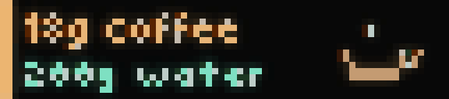

# BrewPilot

Scale three coffee recipes by dose, then follow timed pours and cumulative water targets.

Leave the bar beside the scale and read the target for the current pour. Water targets are cumulative, so the number on the back is the weight you want the scale to reach. There is no subtraction to do with the kettle in your hand.

## Pick the brewer and set the dose

1. Turn the wheel to choose V60, French press or AeroPress. The front shows a water estimate alongside the recipe.
2. Click to edit the coffee dose. Turn until it matches the grounds on your scale. The available range is 8–40 g.
3. In this recording the brew changes from AeroPress to V60. Increasing the dose then updates the water target before the timer starts.


## Start the brew and follow the first pour

1. Click again when you are ready to pour. The front switches from grams of coffee to the first timed step. The V60 recipe begins at **Bloom**.
2. Check the cumulative water weight on the rear display and pour up to that number. Tap **Start** to pause or resume the timer.
3. When a stage expires, click to move on. The app waits for you, so a slow pour does not silently skip to the next step.



## A French press example

At 16 g of coffee, the French press recipe calls for 240 g of water. Select that recipe, enter 16 g and move through its three stages. Click after the final one to finish. The full French press sequence, including pause and resume, was exercised in the firmware test. The GIFs above show a separate V60 run.

## Run in the emulator

Open BUSY Bar Emulator. From this repository, run:

```sh
~/.busy-emulator/bin/busy-emulator dev --once
```

Press **Back** to exit.

The GIFs are excerpts from the emulator recording. The front display is enlarged 9× and the end frames pause for reading.

[Full recording](media/controls.mp4) · [Rear display](screenshots/back-1.png) · [Firmware test](EMULATOR-QA.md) · [MIT license](LICENSE)
